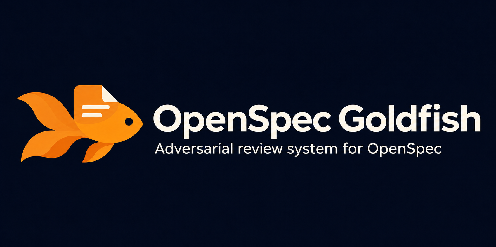
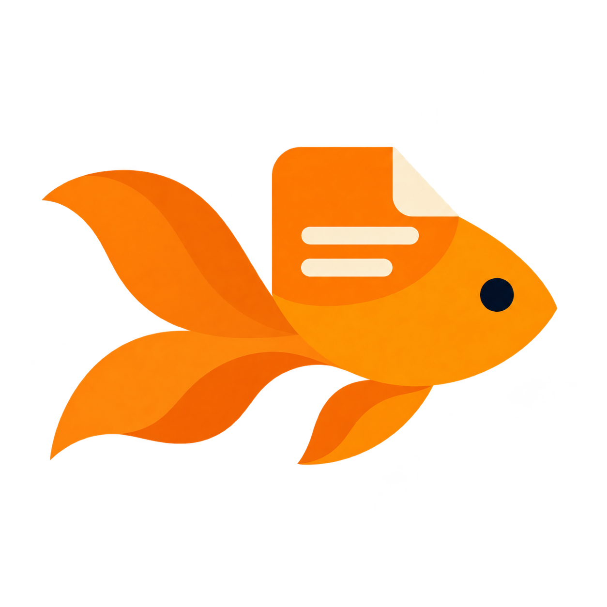

<p align="center"></p>

# OpenSpec Goldfish

[](https://www.npmjs.com/package/openspec-goldfish)

Independent eyes on your proposal, before implementation.

Goldfish gives your OpenSpec planning package a fresh-context cold read, a grounded adversarial review, and evidence-based adjudication. You invoke it manually, read the report, and choose whether to revise.

## Watch the video

[](https://www.youtube.com/watch?v=sUQUOpKxbm8)

[Watch on YouTube](https://www.youtube.com/watch?v=sUQUOpKxbm8)

## Why independent reviews?

A proposal can look complete to its author because the conversation around it fills the gaps. An implementer may only receive the artifacts. Goldfish checks whether those artifacts stand on their own, then challenges them against the repository before implementation begins.

It runs fresh native agents through your existing coding harness. The first two reviewers work independently; the adjudicator receives their findings afterward. Goldfish uses the harness's existing authentication and model configuration, with no separate model service or API credentials.

| Role | Evidence it receives | What it checks |
| --- | --- | --- |
| Cold reader | Planning artifacts and explicit project constraints; no author chat, code, or earlier findings | Reconstructs intent, scope, acceptance evidence, and decisions an implementer would otherwise invent |
| Adversarial reviewer | Planning artifacts plus relevant specs, code, and tests; no author history or cold-reader findings | Feasibility, contracts, failure paths, task order, and cross-artifact consistency |
| Adjudicator | Both reviewers' results and supporting sources | Verifies evidence and classifies every finding as accepted, dismissed, duplicate, or unresolved |

A misunderstanding is a candidate finding, not proof of a defect. The adjudicator must explain its decisions; deterministic helpers validate the result structure and calculate readiness. There is no finding quota. Zero findings is valid. Models can still miss issues, so the report is advisory.

## Install

Requires Node.js 22+ and a supported coding harness. Review also requires OpenSpec with resolved artifact metadata.

Goldfish is available on npm under the MIT license. Install it with:

```bash
npx openspec-goldfish
```

Or specify a harness and scope explicitly:

```bash
npx openspec-goldfish --harness claude --local
npx openspec-goldfish --harness codex --global
npx openspec-goldfish --harness devin --local
```

For development, clone this repository and run `node bin/openspec-goldfish.js` with the same options.

Omit selections to choose interactively. The scope prompt defaults to the current project. In scripts, specify a harness and exactly one of `--local` or `--global`. Installation does not require or initialize an OpenSpec project.

## Review

Complete your OpenSpec proposal, then invoke in your harness:

```text
Claude Code: /openspec-goldfish [change-name]
Codex:       $openspec-goldfish [change-name]
Devin CLI:   /openspec-goldfish [change-name]
```

The change name is optional. Run `/openspec-goldfish` (or `$openspec-goldfish` in Codex) to select the sole active change automatically. If multiple changes are active, Goldfish asks which one to review. Provide a change name to select it directly; omit the square brackets shown above.

These are harness skill invocations. The shell command `openspec-goldfish` runs the installer.

```text
proposal --> manual Goldfish review --> report
                                         |
                                  offer revisions
                                         |
                                  user accepts edits
                                         |
                               offer manual re-review
```

- **Cold reader:** reconstructs intent without the author's conversation or implementation context.
- **Adversarial reviewer:** checks the plan against existing specs, code, and failure modes.
- **Adjudicator:** checks evidence, dismisses noise, and retains unresolved decisions.

Reports distinguish complete/incomplete coverage from ready/revise/undetermined readiness. One accepted major issue blocks readiness. No findings is a valid outcome. Reports are advisory; Goldfish does not gate OpenSpec apply.

## Reading the report

Completion and readiness answer different questions:

| Field | Values | Meaning |
| --- | --- | --- |
| Completion | complete / incomplete | Did all required independent roles finish with valid output? |
| Readiness | ready / revise / undetermined | Are there accepted blocking issues? An incomplete review is undetermined. |
| Freshness | current / stale | Do the planning inputs still match the reviewed snapshot? |

One accepted critical or major finding, or a blocking unresolved question, makes a complete review `revise`. Minor findings remain visible without blocking readiness. If isolation is unavailable or a role fails, Goldfish reports missing coverage instead of simulating reviewers in the author context.

Illustrative report excerpt (not a real review):

```text
Change: add-retry-policy
Completion: complete
Readiness: revise
Freshness: current

C1 | major | accepted | design.md, Retry policy
The proposal promises bounded retries but never defines a limit.
Impact: implementers must invent behavior that changes request load.
Resolution: specify the retry limit and terminal failure behavior.

A1 | minor | dismissed
The proposed error format is already covered by the API contract.
```

Reports are saved under the selected change's `.goldfish/reviews/<run-id>/` as Markdown and JSON, alongside input fingerprints and role results. Each invocation creates a new run. Reports remain immutable; edits to planning inputs make the previous verdict stale. Goldfish does not gate OpenSpec apply or start implementation.

## Revisions

Review only creates reports. Goldfish offers artifact edits and waits for your acceptance, including acceptance of a subset. Product decisions come back to you. Changed planning inputs make the previous verdict stale. Another review requires your explicit invocation; implementation never starts automatically.

## Installation safety

Local installation targets the current directory. Global installation uses the selected harness's user configuration. Rerun the same command to update unmodified Goldfish-owned files. Modified or unrelated files cause a conflict before changes are made; preserve your customizations before resolving that conflict. Multiple harnesses can coexist.

Ownership manifests live under `.goldfish-install/` in the selected configuration root. On a failed write, the installer attempts rollback. An interrupted transaction leaves a `.pending` recovery journal with original file contents encoded as base64 (`null` means newly created). Restore the listed paths and remove that journal only after recovery; the installer refuses to overwrite an interrupted installation. No uninstall command is provided yet.

See [compatibility](docs/compatibility.md), [acceptance status](https://github.com/mehdishahdoost/openspec-goldfish/blob/main/docs/acceptance.md), and [review protocol](docs/review.md) for boundaries and validation status.

## Development

```bash
npm test
npm pack --dry-run
```

No runtime npm dependencies or separate model credentials are required. The selected harness runs the agents using its existing configuration.

<p align="center"></p>

Inspired by the independent critique approach in [openspec-adversarial-multi-agent](https://github.com/VirtualMaestro/openspec-adversarial-multi-agent). Goldfish adds cold reading and a shared protocol across harness adapters.

## Project and license

[Website](https://writebyhumans.com/openspec-goldfish/) · [npm](https://www.npmjs.com/package/openspec-goldfish) · [Release guide](docs/releasing.md)

Released under the [MIT License](LICENSE).
